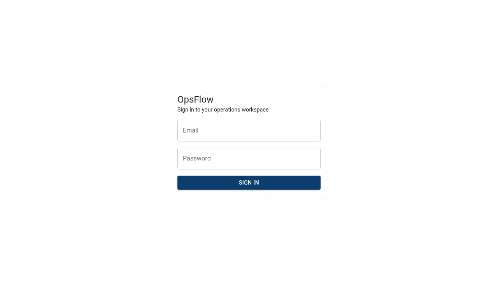
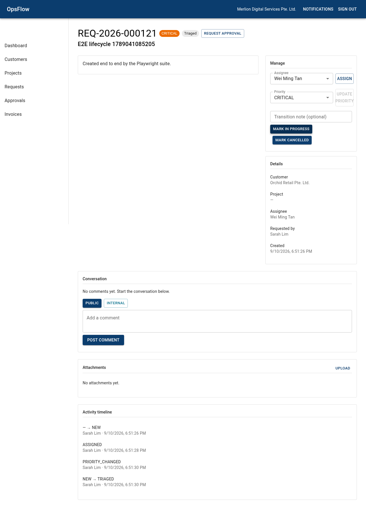
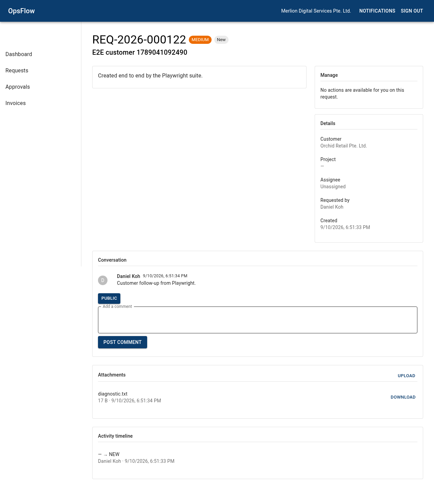
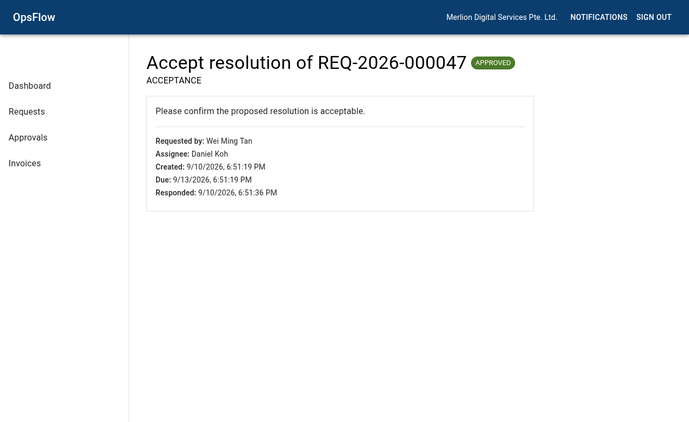
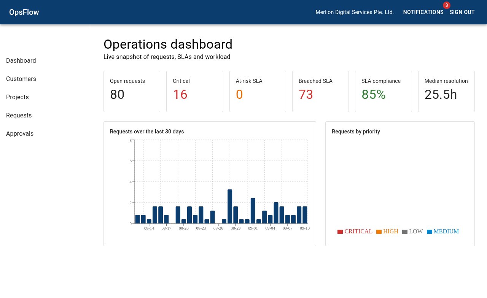

# OpsFlow

> OpsFlow is a production-oriented multi-tenant operations platform built with Laravel 13 and React 19 to demonstrate modern full-stack engineering, relational data modeling, secure tenant isolation, workflow automation, SLA tracking, event-driven processing, real-time collaboration, automated testing, and deployable infrastructure.

**Status:** Phases 0–10 implemented across tenancy/RBAC, customers/projects, the service-request workflow engine, comments/files/real-time, the SLA engine, approvals, invoicing, dashboards and production hardening. See `docs/` for the full PRD and the ADRs.

## Tech Stack

| Layer       | Stack                                                                              |
| ----------- | ---------------------------------------------------------------------------------- |
| Backend     | PHP 8.5 · Laravel 13 · Sanctum · Horizon · Reverb · Pest 4 · PHPStan · Pint        |
| Frontend    | React 19 · TypeScript · Vite 8 · TanStack Query v5 · MUI · React Hook Form · Zod   |
| Data / Ops  | PostgreSQL 18 · Redis 8 · S3 (MinIO) · Nginx · Docker Compose · GitHub Actions      |

## Running Locally

The whole stack (backend + frontend + PostgreSQL + Redis + queue + scheduler + Reverb
websockets + Mailpit + MinIO) runs in Docker, served by nginx at `http://localhost:8080`.

### 1. One command

```bash
make setup
```

`make setup` builds the images, installs Composer/npm dependencies, generates the app
key, and runs migrations with the demo seed. When it finishes the app is already up:
open http://localhost:8080 and sign in with any demo account below.

### 2. Step by step

```bash
make build            # build the Docker images
make up               # start all services
make logs             # tail all service logs
make seed             # re-run seeders against the running stack
```

The frontend dev server only proxies to the backend when nginx is reachable on :8080
(`/api`, `/sanctum`, `/up` are proxied), so start the stack first.

### Demo logins

Password is `password` for every account (provisioned by `make setup`):

| Role     | Email                          |
| -------- | ------------------------------ |
| Admin    | admin@demo.opsflow.local       |
| Manager  | manager@demo.opsflow.local     |
| Operator | operator@demo.opsflow.local    |
| Finance  | finance@demo.opsflow.local     |
| Customer | customer@demo.opsflow.local    |

### Running the frontend against the backend

The app is fully served through nginx at `http://localhost:8080` — no extra step needed
after `make up`. To develop against the Vite dev server instead (HMR at :5173), run it
from the frontend workspace; it proxies API calls to the nginx entrypoint:

```bash
npm run dev --workspace frontend   # http://localhost:5173
```

## End-to-End Tests (Playwright)

`@playwright/test` drives the running app end to end: real browser → UI → `/api/v1` →
Laravel → PostgreSQL. The suite targets the demo seed (E2E-001 manager request lifecycle
and friends in the PRD §54).

### 1. Start the stack and seed it

```bash
make up && make seed
```

### 2. Run the suite

```bash
make e2e                # builds the frontend and runs Playwright against http://localhost:8080
```

or from the repo root: `npm run e2e`. The first run downloads the Chromium browser
(`npx playwright install chromium`); after that it is cached.

Prerequisites: `@playwright/test` is a `devDependencies` entry in `frontend/package.json`
and the browser binaries are installed locally. Run `npm install` (or `make setup`) and
`npx playwright install chromium` once before the first E2E run.

### Scenario screenshots

Every scenario writes a full-page screenshot to
[`frontend/e2e/screenshots/`](frontend/e2e/screenshots), refreshed on each `make e2e`
run. The images below are committed so the README always shows the real, current UI.

#### Login and unauthenticated redirect



#### E2E-001 — Manager request lifecycle

Login → open requests → create a request → assign the operator → change priority →
transition → verify the activity timeline.



#### E2E-002 — Customer collaboration

Customer login → create a request → post a comment → upload an attachment.



#### E2E-003 — Approval

A customer approves a pending approval; the status moves to `APPROVED`.



#### E2E-004 — Cross-role authorization

An operator navigating to an unauthorized route (invoices) is redirected to the
dashboard, and permission-gated navigation is hidden.



### Services

| Service        | URL                     | Notes                       |
| -------------- | ----------------------- | --------------------------- |
| App (nginx)    | http://localhost:8080   | SPA + `/api` + Reverb proxy |
| API health     | http://localhost:8080/up | Laravel healthcheck         |
| API ping       | http://localhost:8080/api/v1/ping | Envelope smoke endpoint |
| Mailpit        | http://localhost:8025   | Local email inspection      |
| MinIO console  | http://localhost:9001   | `opsflow` / `opsflow-secret` |

## Developer Commands

```bash
make up              # start the stack
make down            # stop the stack
make logs            # tail all logs
make backend-test    # Pest test suite
make frontend-test   # Vitest test suite
make e2e             # Playwright E2E against the live stack (builds first)
make lint            # Pint + ESLint
make analyse         # PHPStan + tsc --noEmit + Prettier check
make fresh           # destroy volumes and rebuild images
make shell-backend   # shell into the backend container
make psql            # psql into PostgreSQL
```

Run `make help` for the full list.

## Monorepo

OpsFlow is a single repository holding both applications:

```text
backend/    # Laravel 13 API (Composer)
frontend/   # React 19 SPA (npm)
```

The repo root carries a small orphan root workspace (`package.json`) that orchestrates
both applications so common tasks run from the root. Install everything once with:

```bash
npm install              # frontend workspace + root tooling (concurrently, prettier)
composer --working-dir=backend install
```

Root scripts (`npm run <script>`):

| Script              | What it runs                                                    |
| ------------------- | --------------------------------------------------------------- |
| `npm run dev`       | Backend (`artisan dev`) and frontend (Vite) together via concurrently |
| `npm run build`     | Production build of the frontend (Vite + tsc)                    |
| `npm run test`      | Pest suite then Vitest suite                                      |
| `npm run lint`      | Pint then ESLint                                                  |
| `npm run typecheck` | `tsc --noEmit` for the frontend                                   |
| `npm run analyse`   | PHPStan then `tsc --noEmit`                                       |
| `npm run format`    | Prettier across the repo (Pint owns PHP formatting)               |
| `npm run e2e`       | Playwright E2E suite against the live stack (see "End-to-End Tests") |

npm treats the frontend as the root workspace's only child, so there is a single
`package-lock.json` at the repo root. For full stack orchestration, tests, and
linting, the `make` targets remain the canonical Docker wrapper.

## Repository Layout

```text
backend/    # Laravel 13 API (app, routes/api/v1, Pest tests)
frontend/   # React 19 + TypeScript SPA (Vite, TanStack Query, MUI)
docker/     # Nginx config, PHP-FPM and Node Dockerfiles
docs/       # PRD, ADRs, and the deployment / developer / user / demo guides
.github/    # CI workflow, PR template, Dependabot
compose.yaml
Makefile
```

## Testing

- **Backend:** `make backend-test` — Pest feature/unit/architecture checks (runs
  against an ephemeral environment inside the containers, or locally with SQLite).
- **Frontend:** `make frontend-test` — Vitest + React Testing Library (jsdom).
- **CI:** GitHub Actions runs Pint → PHPStan → Pest and ESLint → tsc → Prettier →
  Vitest → Vite build on every PR (`.github/workflows/ci.yml`).

## Documentation

- Full specification: [docs/OpsFlow_Complete_Technical_PRD.md](docs/OpsFlow_Complete_Technical_PRD.md)
- Architecture decision records: `docs/adr/` (monolith, tenancy, auth, PostgreSQL,
  TanStack Query, after-commit events, SLA calendar)
- [Deployment guide](docs/deployment/README.md) — environments, configuration, production runbook
- [Developer guide](docs/developer-guide/README.md) — architecture, conventions, adding features
- [User guide](docs/user-guide/README.md) — day-to-day usage per role
- [Demo walkthrough](docs/demo-walkthrough/README.md) — the guided recruiter/demo story
- Live API reference: `GET /docs/api` (Swagger UI) when the backend is running

## License

Released under the [MIT License](LICENSE).

Copyright (c) 2026 i4ba1 &lt;muhamadiqbal1987@gmail.com&gt;.
